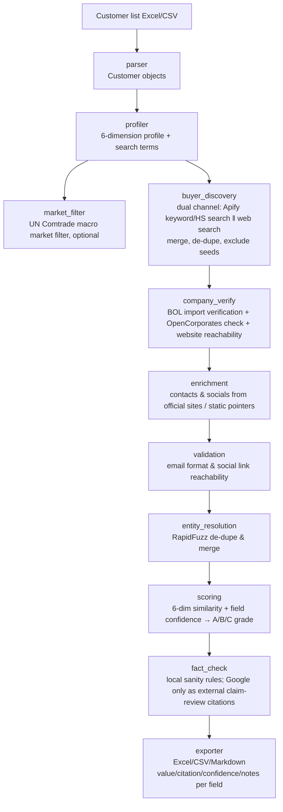

# Similar Value Customer Miner — Engineering

A Kimi Code Skill that **mines similar overseas B2B buyers from a list of closed value customers**, producing a structured lead sheet where every field carries a citation, a confidence score, and a fact-check status.

[中文](ENGINEERING.zh-CN.md) · **English** — [User docs ›](README.en.md)

> Typical scenario: a trade salesperson has 15 closed high-margin customers and wants to quickly find prospects that are "similar in industry / HS code, close in purchase scale, and reachable".

---

## Design philosophy

1. **Explainability first**: every field must answer "where did this value come from, and how reliable is it".
2. **Never pretend to know**: _demo fallback_, generic mailboxes, and unverified social links are all explicitly labeled to prevent misuse.
3. **Replaceable modules**: data sources, scoring rules, and validators are all wired through config files, so a commercial customs database or an ML model can be swapped in later.
4. **MVP runs end-to-end first**: the core pipeline works on demo data with no API keys; add real keys and it switches to real sources immediately.

---

## Core pipeline



---

## Feature list

### Input handling
- Parses Excel/CSV customer lists; supports Chinese and English column-name aliases
- Automatically splits HS codes (`/`, `,`, `;`, `、`)
- Builds a 6-dimension profile from product descriptions, regional positioning, revenue, and other fields

### Candidate discovery (dual channel — see the authoritative "Feature · Service · Key" table below)
- **Web channel** (no key, primary): DuckDuckGo + Bing queries like "US importer/distributor {product}", "HS {code} importer"; yields company name + official domain directly
- **Apify channel** (token required): `zen-studio/importyeti-scraper` returns US importers + shipment volume by keyword/HS (the old `khadinakbar` actor is unmaintained and returns 0 — do not use)
- The two channels are merged and de-duplicated, and **seeds / industry leaders are excluded** (guaranteeing "similar new buyers", not your own customers)
- Without an Apify token / in demo mode: falls back to a built-in offline demo pool of 50 US retailers/distributors
- The BOL actor has been demoted from "discovery" to a "verifier" inside `company_verify`

### Company verification & enrichment
- OpenCorporates registration lookup (optional)
- Scrapes official contact/about pages: emails, phones, social links
- Email-pattern inference (`info@domain` etc.), explicitly labeled as inferred
- Static public social-media pointer completion for known large companies

### Validation & de-duplication
- Email format validation
- Social link HTTP HEAD reachability checks
- RapidFuzz fuzzy company-name matching for de-duplication + best-field merge

### Scoring & grading
- **fit_score** (0–1): similarity between candidate and target profile (Jaccard-weighted over HS / industry / products)
- **priority_score** (0–1): outreach priority = import strength (shipment volume) + fit + contact completeness; **export is sorted by this**
- **grade A/B/C**: combined field-level confidence (≥0.8 / 0.5–0.79 / <0.5) — data trustworthiness only, **not** outreach priority

### Fact checking
- Purchase ≤ revenue × 70%
- Company existence, contact reachability, HS consistency, region consistency
- Outputs `passed / pending / failed` status

### Export (product-grade Excel)
- **Lead list** (first sheet): compact Chinese columns — priority / grade / fit / company / website / HS·products / contact / email / phone / socials / shipments·purchase(proxy) — ready for business use
- **Results**: full fields with **Chinese headers** + four columns per field (`value / citation / confidence / notes`), fully auditable
- **Summary**: statistics + **A/B/C grading legend** (thresholds, meaning, suggested action — included in every output)
- Microsoft YaHei throughout, green section titles, light-green headers, alternating rows, frozen header, semantic color blocks (proxy column gets a warning fill)
- CSV / Markdown also supported

---

## Feature · Service · Key · Pricing (authoritative)

> For each capability: **which external service, which key, what the fallback is without a key, and the cheapest paid tier**. Use this to decide which keys to configure and whether to pay.

| Capability (feature) | External service | Key (config / env var) | Fallback without key / on outage | Cheapest paid tier | Local status |
|---|---|---|---|---|---|
| **Discovery · Web channel** | DuckDuckGo + Bing (keyless web search) | **None** | — (it IS the free primary; yields company name + website directly) | **$0 forever** | ✅ Works (current **primary** discovery source) |
| **Discovery · Apify channel** | Apify (`zen-studio/importyeti-scraper`, keyword/HS search) | `apify.api_token` / `APIFY_API_TOKEN` | Web channel covers independently | Free $5/mo credits; Personal **$49/mo** + actor result fees ~$2–30/1000 | ✅ Works (returns US importers + shipment volume) |
| **BOL import verification** (shipment volume / HS / shipping spend) | Apify (`jungle_synthesizer` BOL actor) | Same `apify.api_token` | Skipped, marked "unverified", `shipment_frequency` left empty | Same as Apify | ✅ Works |
| **Contact / email enrichment** | Hunter.io | `hunter.api_key` / `HUNTER_API_KEY` | Scrape emails from official sites + `info@domain` inference (labeled as inferred) | Free **25 searches + 50 verifications/mo**; Starter **$34/mo** (annual) → 500 searches | ✅ Free tier, ~31 searches left this month |
| **Company registration check** | OpenCorporates | `opencorporates.api_token` / `OPENCORPORATES_API_TOKEN` (optional) | Reachable website counts as existing, with lower confidence | Free tier (low volume); commercial API from ~**£2,250/yr** | ⬜ Not configured |
| **Macro market filter** | UN Comtrade | `comtrade.subscription_key` / `COMTRADE_SUBSCRIPTION_KEY` (optional) | Runs at low frequency without a key; skipped on failure | **Free tier**; subscription raises quota | ⬜ Not configured |
| **External claim review** (supplementary citations) | Google Fact Check Tools | `google.fact_check_api_key` / `GOOGLE_FACT_CHECK_API_KEY` (optional) | Step disabled; doesn't affect the main chain (supplementary anyway) | **Free** (any Google Cloud API key) | ✅ Configured |
| **Site scraping · similarity/de-dupe · scoring** | Local libs (requests + BeautifulSoup + RapidFuzz) | **None** | — | **$0** (open source, MIT) | ✅ Works |

### Conclusions

- **Zero cost gets you a deliverable lead list end-to-end**: web discovery + site scraping + Hunter Free + Google Fact Check (free) + Comtrade free tier + local scoring — **all free**. Even without an Apify token, these free capabilities alone produce a real buyer list (with emails/contacts).
- **Apify (paid) unlocks two extras** (from $49/mo Personal):
  1. `apify_kw` uses `zen-studio/importyeti-scraper` for **precise US-importer discovery by keyword/HS + shipment volume** (an import-strength signal the web channel can't provide).
  2. **BOL verification** fills in "shipment frequency / bill-of-lading volume / shipping-spend proxy".
- **Phase-2 commercial sources** (not wired in, no keys): ImportGenius/Panjiva/Volza (real customs purchase values, from $125–399/mo), Apollo/ZoomInfo (firmographic revenue/contacts, from $49/user/mo).
- **Cheapest "serious paid" combo**: Apify Personal **$49/mo** + Hunter Starter **$34/mo** ≈ **$83/mo**, giving "precise HS customs discovery + shipment verification + 500 email lookups".
- **Picking the right actor matters**: several same-named ImportYeti actors exist on the Apify Store with varying quality. This project discovers with `zen-studio/importyeti-scraper` (11k+ runs, well maintained) and verifies with `jungle_synthesizer/...-bill-of-lading-scraper`; the old `khadinakbar` actor is unmaintained (HTTP failures, returns 0) — do not use.

> Full pricing and cost-saving strategies: [`docs/pricing.md`](docs/pricing.md).

---

## Data provider overview

| Provider | What it is | Used here for | How to get a key | Billing |
|----------|-----------|---------------|------------------|---------|
| **Apify** [apify.com](https://apify.com) | Cloud scraping / actor platform | Runs ImportYeti actors (keyword discovery + BOL verification) | Token on signup (Settings → Integrations) | Platform compute credits + actor result fees; Free $5/mo, Personal $49/mo |
| ├ `zen-studio/importyeti-scraper` | ImportYeti import-records actor (11k+ runs, actively maintained) | **Discovery**: keyword/HS → US importers + shipment volume | No separate signup; call with Apify token | Billed per result |
| └ `jungle_synthesizer/...-bill-of-lading-scraper` | ImportYeti bill-of-lading actor | **Verification**: company name → BOL → shipment volume / HS / freight proxy | Same as above | Billed per result |
| **Hunter.io** [hunter.io](https://hunter.io) | Email discovery / verification | Finds decision-maker emails + names/titles by domain | Sign up → Dashboard → API | Free 25 searches + 50 verifications/mo; Starter $34/mo (annual) → 500 searches |
| **DuckDuckGo / Bing** | Public web search | Web discovery channel (keyless, in-process HTML scraping) | No key needed | Free |
| **OpenCorporates** [opencorporates.com](https://opencorporates.com) | Global company registry | Company existence / registration checks (optional) | Apply for an API token | Free low volume; commercial API ~£2,250/yr |
| **UN Comtrade** [comtrade.un.org](https://comtrade.un.org) | UN country-HS trade statistics | Macro market filtering (optional) | Optional subscription key | Free tier + subscription |
| **Google Fact Check Tools** | Published fact-check search | Supplementary external claim-review citations (not proof of revenue/purchases) | Google Cloud → enable API → key | Free |
| **RapidFuzz / requests / BeautifulSoup** | Local open-source libs | De-dupe, similarity, site scraping | None | Free (MIT / open source) |

**Not wired in (phase 2)**: ImportGenius / Panjiva / Volza (real customs purchase values, from $125–399/mo), Apollo / ZoomInfo (firmographic revenue/contacts, from $49/user/mo) — require new paid accounts; integration points are already in the code.

---

## Referenced open-source projects / data-source mechanisms

| Capability | Project / data source | Role | License / cost |
|------------|----------------------|------|----------------|
| US buyer discovery | [ImportYeti](https://www.importyeti.com/) + [Apify actor](https://apify.com/zen-studio/importyeti-scraper) (zen-studio) + keyless web search | Keyword/HS → US importers + shipment volume | Apify billed per call, token required; web free |
| Macro market filter | [UN Comtrade](https://comtrade.un.org/) / `comtradeapicall` | Country-HS trade statistics | Free / subscription |
| Company verification | [OpenCorporates](https://opencorporates.com/) | Registration status, address, directors | Free quota + paid token |
| Fuzzy company matching | [RapidFuzz](https://github.com/maxbachmann/RapidFuzz) | De-duplication, similarity | MIT |
| Site scraping | `requests` + `beautifulsoup4` | Email/phone/social extraction from static pages | - |
| Email verification | `AfterShip/email-verifier` (reserved interface) | SMTP verification | - |
| Social reverse lookup | [Sherlock](https://github.com/sherlock-project/sherlock) (reserved interface) | Username existence across platforms | MIT |
| Fact checking | In-house rule engine (Loki / SemanticCite reserved for phase 2) | Claim consistency checks | - |

> **Note**: logged-in LinkedIn scraping was explicitly cut from the MVP for compliance risk; only LinkedIn company-page URLs found on official/public pages are output.

---

## Install

```bash
pip install -r requirements.txt
```

Requires: Python 3.10+, pandas, openpyxl, requests, pyyaml, rapidfuzz, beautifulsoup4, comtradeapicall.

---

## Quick start

### 1. Run with sample data

```bash
python -m src.cli \
  --input examples/sample_customers.xlsx \
  --output output/result.xlsx
```

The default `--mode demo` does not load `config/local.yaml`; it uses demo fallback to verify the end-to-end flow, with every record labeled `demo fallback`.

### 2. Switch to real ImportYeti data

```bash
cp config/datasources.yaml config/local.yaml
# Edit config/local.yaml, fill in apify.api_token and hunter.api_key (optional)
python -m src.cli \
  --input examples/sample_customers.xlsx \
  --output output/result.xlsx \
  --config config/local.yaml \
  --mode live
```

`--mode live` runs the full dual-channel chain: **Apify keyword discovery (zen-studio) + web discovery → merge, de-dupe, exclude seeds → BOL verification (shipment volume / HS / spend) → domain resolution → Hunter contacts → scoring → export**. Cost guardrails live in the `discovery` section of the config (`max_verify_candidates`, `hunter_max_lookups`).

```bash
# Smoke: verify the BOL actor returns real dataset rows (limit 1-3)
python scripts/live_smoke.py --actor-role fallback --query "apple" --limit 1
```

### 3. Validate the output

```bash
python scripts/check_output.py output/result.xlsx

# Live/business-field acceptance: requires company name, shipment frequency, HS or product, source_url;
# missing purchase value/email is a warning for now.
python scripts/check_output.py output/result.xlsx --min-ab 0 --business-fields
```

---

## Input format

Excel/CSV with at least:

| Column | Description | Required |
|--------|-------------|----------|
| `客户序号` / `ID` / `id` | Unique customer identifier | ✅ |
| `HS CODE` / `hs_code` / `海关编码` | HS code, multi-value allowed | ✅ |
| `客户名` / `公司名称` / `name` | Customer name | ❌ |
| `主营商品` / `main_products` | Product description | ❌ |
| `客户区域定位` / `region_positioning` | Nationwide/regional/channel etc. | ❌ |
| `客户营业额` / `customer_revenue` | For size bucketing | ❌ |
| `年发货频次` / `annual_shipment_frequency` | For frequency bucketing | ❌ |
| `年中国采购额度` / `annual_china_purchase` | For purchase scale | ❌ |
| `客户商业定位` / `business_positioning` | Value/scale positioning | ❌ |

More column aliases in `config/default.yaml`.

---

## Output format

Every field expands into four columns:

| Suffix | Meaning |
|--------|---------|
| `_value` | Field value |
| `_citation` | Data source |
| `_confidence` | Confidence 0-1 |
| `_notes` | Notes / inference explanation |

Example fields:

- `company_name_value` / `company_name_citation` / `company_name_confidence` / `company_name_notes`
- `revenue_value` / `revenue_citation` / `revenue_confidence` / `revenue_notes`
- `email_value` / `email_citation` / `email_confidence` / `email_notes`
- `linkedin_value` / `linkedin_citation` / `linkedin_confidence` / `linkedin_notes`

Summary fields:

- `similarity_score`: 6-dimension similarity to the seed profile
- `overall_confidence`: combined field confidence
- `grade`: A/B/C
- `fact_check_status`: passed / pending / failed
- `all_citations`: JSON of all data sources
- `notes`: human-readable remarks (demo fallback / department email / external claim review etc.)

---

## Configuration

### Defaults: `config/default.yaml`

Column aliases, output format, grading thresholds, logging, caching, etc.

### Data sources: `config/datasources.yaml` → copy to `config/local.yaml`

```yaml
apify:
  api_token: ""  # Required for ImportYeti actors; or APIFY_API_TOKEN env var
  discovery_actor_id: "zen-studio~importyeti-scraper"          # keyword/HS discovery (well maintained)
  fallback_actor_id: "jungle_synthesizer~importyeti-bill-of-lading-scraper"  # BOL verification

opencorporates:
  api_token: ""  # Optional, raises rate limit; or OPENCORPORATES_API_TOKEN env var

hunter:
  api_key: ""    # Optional, email discovery; or HUNTER_API_KEY env var

comtrade:
  subscription_key: ""  # Optional; or COMTRADE_SUBSCRIPTION_KEY env var

google:
  fact_check_api_key: ""      # Optional, Google Fact Check Tools API key; or GOOGLE_FACT_CHECK_API_KEY env var
  fact_check_enabled: false   # Whether to enable external claim-review search (off by default to avoid unneeded API calls)
  min_confidence: 0.7         # Only run external claim review for companies with overall_confidence >= this
```

`local.yaml` is in `.gitignore` and never committed. Tests and demo mode skip local secrets; only `--mode live` loads local config by default, or use `--no-local` to disable explicitly.

---

## Testing

```bash
pytest tests/ -v
```

Current coverage: parser, profiler, scoring, entity_resolution, exporter, fact_check, buyer_discovery (mock), live_smoke (mock), pipeline (end-to-end).

---

## Known limitations

1. **Data-source coverage**: the MVP's main source is US importers (ImportYeti). Global company-level customs data needs a commercial database (ImportGenius / Panjiva / Volza etc.) in phase 2.
2. **Contact trustworthiness**: generic mailboxes like `sales@domain`, `info@domain` are contact methods only and never generate a contact name; `contact_name` / `contact_title` come only from structured person fields (e.g. Hunter).
3. **Revenue estimates**: private-company revenue is a range estimate with medium confidence.
4. **Demo fallback**: without an Apify token, the 50 candidates are a pool of known US retailers for pipeline verification — not real ImportYeti results.
5. **Google Fact Check semantics**: Google Fact Check Tools only searches published external claim reviews as supplementary citations; it does not prove company revenue, purchase value, or customs data.
6. **Purchase field split (honest semantics)**: BOL `est_shipping_spend_usd` goes only into `estimated_shipping_spend` (a proxy, with `procurement_proxy_notes`) and **no longer** masquerades as purchase value; `customs_china_purchase` is filled only when a real customs source is wired in (empty for now); the old `china_purchase` field is deprecated.
7. **Compliance boundary**: site scraping respects `robots.txt` and reasonable rate limits; no logged-in personal data is collected.

---

## Phase-2 roadmap

- [ ] Wire in a commercial customs database (ImportGenius / Panjiva / Volza)
- [ ] Wire in B2B contact APIs (Apollo / ZoomInfo / Hunter)
- [ ] Train / integrate an ML similarity model
- [ ] Package as an MCP server
- [ ] Multi-language support & web UI dashboard

---

## License

MIT
