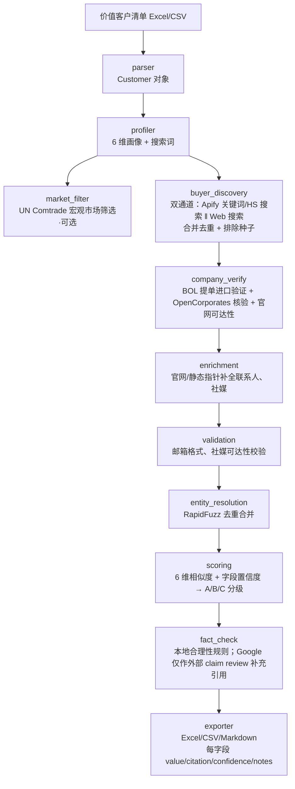

# Similar Value Customer Miner — 工程文档

一个 Kimi Code Skill，用于**从已成交的价值客户清单中，挖掘相似的海外 B2B 买家**，输出带来源（citation）、置信度（confidence）和事实核查状态的结构化线索表。

**中文** · [English](ENGINEERING.md) — [用户文档 ›](README.md)

> 典型场景：外贸销售手里有 15 家已成交的高毛利客户，想快速找到"目标行业/HS CODE 类似、采购规模接近、可触达"的潜在新客户。

---

## 设计哲学

1. **可解释优先**：每个字段必须能回答"这个值从哪来的、有多可靠"。
2. **不假装知道**：_demo fallback_、通用邮箱、未验证社媒都会明确标注，避免误用。
3. **模块可替换**：数据源、评分规则、验证器都通过配置文件接入，方便后续换商业海关库或加 ML 模型。
4. **MVP 先跑通**：核心流程在无 API key 时也能用 demo 数据验证端到端；配置真实 key 后立即切换真实数据源。

---

## 核心流程



---

## Feature 列表

### 输入处理
- 解析 Excel/CSV 客户清单，支持中英文列名别名
- 自动拆分 HS CODE（`/`, `,`, `;`, `、`）
- 从产品描述、区域定位、营业额等字段生成 6 维画像

### 候选公司发现（双通道，见下方「功能 · 服务 · Key 一览」）
- **Web 通道**（无 key，主力）：DuckDuckGo + Bing 搜 "US importer/distributor {product}"、"HS {code} importer"，直接产出公司名 + 官网 domain
- **Apify 通道**（需 token）：`zen-studio/importyeti-scraper` 按关键词/HS 返回美国进口商 + 发货量（旧的 `khadinakbar` actor 已失修/返回 0，勿用）
- 两通道合并去重，并**排除种子/行业龙头本身**（保证是"相似新买家"而非客户自己）
- 无 Apify token / demo 模式：走内置 50 家美国零售商/分销商离线 demo 池
- BOL 提单 Actor 已从"发现"降级为 `company_verify` 里的"验证器"

### 公司核验与补全
- OpenCorporates 公司注册信息核验（可选）
- 官网 contact/about 页抓取：邮箱、电话、社媒链接
- 邮箱模式推断（`info@domain` 等），明确标注为推断
- 已知大公司静态公开社媒指针补全

### 验证与去重
- 邮箱格式校验
- 社媒链接 HTTP HEAD 可达性检查
- RapidFuzz 公司名模糊匹配去重 + 最佳字段合并

### 评分与分级
- **fit_score**（0–1）：候选与目标画像的相似度（HS / 行业 / 产品 Jaccard 加权）
- **priority_score**（0–1）：触达优先级 = 进口强度(发货量) + fit + 可触达完整度；**导出按此排序**
- **grade A/B/C**：字段级综合置信度（≥0.8 / 0.5–0.79 / <0.5）——只表示"数据可信度"，**不等于**触达优先级

### 事实核查
- 采购额 ≤ 营业额 × 70%
- 公司存在性、联系方式可达性、HS 一致性、区域一致性
- 输出 passed / pending / failed 状态

### 导出（产品级 Excel）
- **线索名单**（首个 sheet）：精简中文列——优先级 / 评级 / 匹配度 / 公司名 / 官网 / HS·主营 / 联系人 / 邮箱 / 电话 / 社媒 / 发货·采购(proxy)，业务可直接用
- **Results**：全字段**中文表头** + 每字段 `值 / 来源 / 可信度 / 说明` 四列，可审计溯源
- **Summary**：统计 + **A/B/C 评级说明**（阈值·含义·建议动作，每次输出必含）
- 全表**微软雅黑**、绿色分区标题、浅绿表头、交替行、冻结表头、语义色块（proxy 列 warning 底色）
- 同时支持 CSV / Markdown

---

## 功能 · 服务 · Key · 付费一览（权威梳理）

> 每个能力用到**哪个外部服务、哪个 key、无 key 时怎么降级、最低一档付费**。以此判断该配哪些 key、要不要花钱。

| 能力（feature） | 外部服务 | 需要的 key（配置项 / 环境变量） | 无 key / 服务挂掉时降级 | 最低一档付费 | 本机当前状态 |
|---|---|---|---|---|---|
| **候选发现 · Web 通道** | DuckDuckGo + Bing（无 key 网页搜索） | **无** | —（它本身就是免费主力，直接产出公司名 + 官网） | **$0 永久免费** | ✅ 可用（当前**主**发现源） |
| **候选发现 · Apify 通道** | Apify（`zen-studio/importyeti-scraper` 关键词/HS 搜索） | `apify.api_token` / `APIFY_API_TOKEN` | Web 通道独立顶上 | Free $5/月额度；Personal **$49/月** + Actor 结果费 ~$2–30/1000 | ✅ 可用（返回美国进口商 + 发货量） |
| **BOL 进口验证**（发货量/HS/shipping spend） | Apify（`jungle_synthesizer` BOL 提单 Actor） | 同上 `apify.api_token` | 跳过并标注"未验证"，`shipment_frequency` 留空 | 同 Apify | ✅ 可用 |
| **联系人 / 邮箱补全** | Hunter.io | `hunter.api_key` / `HUNTER_API_KEY` | 官网抓邮箱 + `info@domain` 推断（标注为推断） | Free **25 搜索 + 50 验证/月**；Starter **$34/月**（年付）→ 500 搜索 | ✅ Free 版，本月剩 ~31 搜索 |
| **公司注册核验** | OpenCorporates | `opencorporates.api_token` / `OPENCORPORATES_API_TOKEN`（可选） | 官网可达即视为存在，降低置信度 | Free tier（低频）；商业 API 约 **£2,250/年** 起 | ⬜ 未配置 |
| **宏观市场筛选** | UN Comtrade | `comtrade.subscription_key` / `COMTRADE_SUBSCRIPTION_KEY`（可选） | 无 key 也能低频跑，失败即跳过 | **Free tier**；订阅提额度 | ⬜ 未配置 |
| **外部 claim 核查**（补充引用） | Google Fact Check Tools | `google.fact_check_api_key` / `GOOGLE_FACT_CHECK_API_KEY`（可选） | 关闭该步；不影响主链（本就只是补充引用） | **免费**（有 Google Cloud API key 即可） | ✅ 已配置 |
| **官网抓取 · 相似度/去重 · 评分** | 本地库（requests + BeautifulSoup + RapidFuzz） | **无** | — | **$0**（开源 MIT） | ✅ 可用 |

### 结论

- **零成本即可端到端出可交付名单**：Web 发现 + 官网抓取 + Hunter Free + Google Fact Check（免费）+ Comtrade 免费档 + 本地评分——**全部免费**。即使不配 Apify token，仅靠这些免费能力就能跑出真实买家名单（含邮箱/联系人）。
- **Apify（付费）额外解锁两项**（$49/月 Personal 起）：
  1. `apify_kw` 通过 `zen-studio/importyeti-scraper` 按关键词/HS **精确发现美国进口商 + 发货量**（web 通道给不了的进口强度信号）。
  2. **BOL 验证**补齐"发货频次/提单量/shipping spend proxy"。
- **二期商业数据源**（未接入，无 key）：ImportGenius/Panjiva/Volza（真·海关采购额，$125–399/月起）、Apollo/ZoomInfo（firmographic 营收/联系人，$49/人/月起）。
- **最低一档"认真付费"组合**：Apify Personal **$49/月** + Hunter Starter **$34/月** ≈ **$83/月**，即可拿到"HS 精确海关发现 + 发货量验证 + 500 邮箱额度"。
- **选对 Actor 很关键**：ImportYeti 类 actor 在 Apify Store 有多个同名版本，质量参差。本项目发现用 `zen-studio/importyeti-scraper`（1.1w+ 运行、维护良好），验证用 `jungle_synthesizer/...-bill-of-lading-scraper`；旧的 `khadinakbar` actor 已失修（HTTP 失败、返回 0），勿用。

> 完整定价与省钱策略见 [`docs/pricing.md`](docs/pricing.md)。

---

## 数据服务商简介

| 服务商 | 是什么 | 本项目用来 | 如何拿 key | 计费 |
|--------|--------|-----------|-----------|------|
| **Apify** [apify.com](https://apify.com) | 云爬虫/Actor 运行平台 | 运行 ImportYeti Actor（关键词发现 + BOL 提单验证） | 注册即得 token（Settings → Integrations） | 平台 compute credits + Actor 结果费；Free $5/月，Personal $49/月 |
| ├ `zen-studio/importyeti-scraper` | ImportYeti 进口记录 Actor（1.1w+ 运行，活跃维护） | **发现**：关键词/HS → 美国进口商 + 发货量 | 无需单独申请，用 Apify token 调用 | 按结果数计费 |
| └ `jungle_synthesizer/...-bill-of-lading-scraper` | ImportYeti 提单 Actor | **验证**：按公司名查提单 → 发货量/HS/运费 proxy | 同上 | 按结果数计费 |
| **Hunter.io** [hunter.io](https://hunter.io) | 邮箱发现/验证 | 按 domain 找决策人邮箱 + 姓名/职位 | 注册 → Dashboard → API | Free 25 搜索+50 验证/月；Starter $34/月(年付)→500 搜索 |
| **DuckDuckGo / Bing** | 公共网页搜索 | Web 发现通道（无 key，进程内 HTML 抓取） | 无需 key | 免费 |
| **OpenCorporates** [opencorporates.com](https://opencorporates.com) | 全球公司注册库 | 公司存在性/注册信息核验（可选） | 申请 API token | Free 低频；商业 API ~£2,250/年 |
| **UN Comtrade** [comtrade.un.org](https://comtrade.un.org) | 联合国国家-HS 贸易统计 | 宏观市场筛选（可选） | 可选 subscription key | 免费档 + 订阅提额 |
| **Google Fact Check Tools** | 已发布事实核查检索 | 补充外部 claim review 引用（非营收/采购证明） | Google Cloud → 启用 API → key | 免费 |
| **RapidFuzz / requests / BeautifulSoup** | 本地开源库 | 去重·相似度·官网抓取 | 无 | 免费（MIT/开源） |

**未接入（二期）**：ImportGenius / Panjiva / Volza（真·海关采购额，$125–399/月起）、Apollo / ZoomInfo（firmographic 营收/联系人，$49/人/月起）——需新开付费账号，代码已预留接入点。

---

## 引用的开源项目 / 数据源机制

| 能力 | 引用项目 / 数据源 | 作用 | 许可/成本 |
|------|------------------|------|----------|
| 美国买家发现 | [ImportYeti](https://www.importyeti.com/) + [Apify Actor](https://apify.com/zen-studio/importyeti-scraper)（zen-studio）+ 无 key Web 搜索 | 关键词/HS → 美国进口商 + 发货量 | Apify 按调用计费，需 token；Web 免费 |
| 宏观市场筛选 | [UN Comtrade](https://comtrade.un.org/) / `comtradeapicall` | 国家-HS 级贸易统计 | 免费/订阅 |
| 公司核验 | [OpenCorporates](https://opencorporates.com/) | 公司注册状态、地址、董事 | 免费额度 + 付费 token |
| 公司名模糊匹配 | [RapidFuzz](https://github.com/maxbachmann/RapidFuzz) | 去重、相似度 | MIT |
| 官网抓取 | `requests` + `beautifulsoup4` | 静态页面邮箱/电话/社媒提取 | - |
| 邮箱验证 | `AfterShip/email-verifier`（预留接口） | SMTP 验证 | - |
| 社媒反查 | [Sherlock](https://github.com/sherlock-project/sherlock)（预留接口） | 用户名多平台存在性探测 | MIT |
| 事实核查 | 自研规则引擎（Loki / SemanticCite 二期预留） | 主张一致性校验 | - |

> **注意**：LinkedIn 登录态抓取因合规风险高，MVP 明确砍掉；只输出官网/公开页面能找到的 LinkedIn 公司页链接。

---

## 安装

```bash
pip install -r requirements.txt
```

依赖：Python 3.10+，pandas, openpyxl, requests, pyyaml, rapidfuzz, beautifulsoup4, comtradeapicall。

---

## 快速开始

### 1. 用示例数据跑通

```bash
python -m src.cli \
  --input examples/sample_customers.xlsx \
  --output output/result.xlsx
```

默认 `--mode demo` 不加载 `config/local.yaml`，会使用 demo fallback 验证端到端流程，每条都标注 `demo fallback`。

### 2. 换成真实 ImportYeti 数据

```bash
cp config/datasources.yaml config/local.yaml
# 编辑 config/local.yaml，填入 apify.api_token 和 hunter.api_key（可选）
python -m src.cli \
  --input examples/sample_customers.xlsx \
  --output output/result.xlsx \
  --config config/local.yaml \
  --mode live
```

`--mode live` 会跑完整双通道链路：**Apify 关键词发现（zen-studio）+ Web 发现 → 合并去重排除种子 → BOL 提单验证（补发货量/HS/spend）→ domain 解析 → Hunter 联系人 → 评分 → 导出**。成本护栏见 `config` 的 `discovery` 段（`max_verify_candidates`、`hunter_max_lookups`）。

```bash
# 冒烟：验证 BOL 提单 Actor 可返回真实 dataset row（limit 1-3）
python scripts/live_smoke.py --actor-role fallback --query "apple" --limit 1
```

### 3. 验证输出

```bash
python scripts/check_output.py output/result.xlsx

# Live/业务字段验收：要求公司名、发货频次、HS 或产品、source_url；采购额/邮箱缺失先作为 warning。
python scripts/check_output.py output/result.xlsx --min-ab 0 --business-fields
```

---

## 输入格式

Excel/CSV，至少包含：

| 列 | 说明 | 必填 |
|----|------|------|
| `客户序号` / `ID` / `id` | 客户唯一标识 | ✅ |
| `HS CODE` / `hs_code` / `海关编码` | HS 编码，可多值 | ✅ |
| `客户名` / `公司名称` / `name` | 客户名 | ❌ |
| `主营商品` / `main_products` | 产品描述 | ❌ |
| `客户区域定位` / `region_positioning` | 全美/区域/渠道等 | ❌ |
| `客户营业额` / `customer_revenue` | 用于规模分桶 | ❌ |
| `年发货频次` / `annual_shipment_frequency` | 用于频次分桶 | ❌ |
| `年中国采购额度` / `annual_china_purchase` | 用于采购规模 | ❌ |
| `客户商业定位` / `business_positioning` | 价值/规模路线 | ❌ |

更多列名别名见 `config/default.yaml`。

---

## 输出格式

每个字段拆成四列：

| 后缀 | 含义 |
|------|------|
| `_value` | 字段值 |
| `_citation` | 数据来源 |
| `_confidence` | 置信度 0-1 |
| `_notes` | 备注/推断说明 |

示例字段：

- `company_name_value` / `company_name_citation` / `company_name_confidence` / `company_name_notes`
- `revenue_value` / `revenue_citation` / `revenue_confidence` / `revenue_notes`
- `email_value` / `email_citation` / `email_confidence` / `email_notes`
- `linkedin_value` / `linkedin_citation` / `linkedin_confidence` / `linkedin_notes`

汇总字段：

- `similarity_score`：与种子画像的 6 维相似度
- `overall_confidence`：综合字段置信度
- `grade`：A/B/C
- `fact_check_status`：passed / pending / failed
- `all_citations`：所有数据来源 JSON
- `notes`：人类可读备注（demo fallback / department email / external claim review 等）

---

## 配置

### 默认配置：`config/default.yaml`

列名别名、输出格式、分级阈值、日志、缓存等。

### 数据源配置：`config/datasources.yaml` → 复制为 `config/local.yaml`

```yaml
apify:
  api_token: ""  # ImportYeti Actor 必需；也可用 APIFY_API_TOKEN 环境变量
  discovery_actor_id: "zen-studio~importyeti-scraper"          # 关键词/HS 发现（维护良好）
  fallback_actor_id: "jungle_synthesizer~importyeti-bill-of-lading-scraper"  # BOL 验证

opencorporates:
  api_token: ""  # 可选，提升 rate limit；也可用 OPENCORPORATES_API_TOKEN 环境变量

hunter:
  api_key: ""    # 可选，邮箱发现；也可用 HUNTER_API_KEY 环境变量

comtrade:
  subscription_key: ""  # 可选；也可用 COMTRADE_SUBSCRIPTION_KEY 环境变量

google:
  fact_check_api_key: ""      # 可选，Google Fact Check Tools API key；也可用 GOOGLE_FACT_CHECK_API_KEY 环境变量
  fact_check_enabled: false   # 是否启用外部 claim review 搜索（默认关闭，避免不必要的 API 调用）
  min_confidence: 0.7         # 仅对 overall_confidence >= 该值的公司做外部 claim review 搜索
```

`local.yaml` 已加入 `.gitignore`，不会提交。测试和 demo 模式会跳过本地 secrets；只有 `--mode live` 默认加载本地配置，或使用 `--no-local` 显式关闭。

---

## 测试

```bash
pytest tests/ -v
```

当前测试覆盖：parser、profiler、scoring、entity_resolution、exporter、fact_check、buyer_discovery（mock）、live_smoke（mock）、pipeline（端到端）。

---

## 已知限制

1. **数据源覆盖**：MVP 主数据源是美国进口商（ImportYeti）。全球公司级海关数据需要商业库（ImportGenius / Panjiva / Volza 等）二期接入。
2. **联系人可信度**：`sales@domain`、`info@domain` 等通用邮箱只作为联系方式，不会生成联系人姓名；`contact_name` / `contact_title` 只使用 Hunter 等结构化 person 字段。
3. **营业额估算**：非上市公司营业额为区间估算，置信度中等。
4. **Demo fallback**：无 Apify token 时输出的 50 家候选是已知美国零售商池，用于验证流程，不是真实 ImportYeti 结果。
5. **Google Fact Check 语义**：Google Fact Check Tools 只搜索已发布的外部 claim review，可作为补充引用；它不证明公司营业额、采购额或海关数据。
6. **采购额字段已拆分（诚实语义）**：BOL 的 `est_shipping_spend_usd` 只写入 `estimated_shipping_spend`（proxy，附 `procurement_proxy_notes` 标注），**不再**冒充采购额；`customs_china_purchase` 仅在接入真·海关源时才填（本期留空）；旧的 `china_purchase` 字段已弃用。
7. **合规边界**：官网抓取遵守 `robots.txt` 与合理 rate limit；不抓取登录态个人数据。

---

## 二期 Roadmap

- [ ] 接入商业海关库（ImportGenius / Panjiva / Volza）
- [ ] 接入 B2B 联系人 API（Apollo / ZoomInfo / Hunter）
- [ ] 训练/接入 ML 相似度模型
- [ ] 封装为 MCP Server
- [ ] 多语言支持与 Web UI 看板

---

## License

MIT
