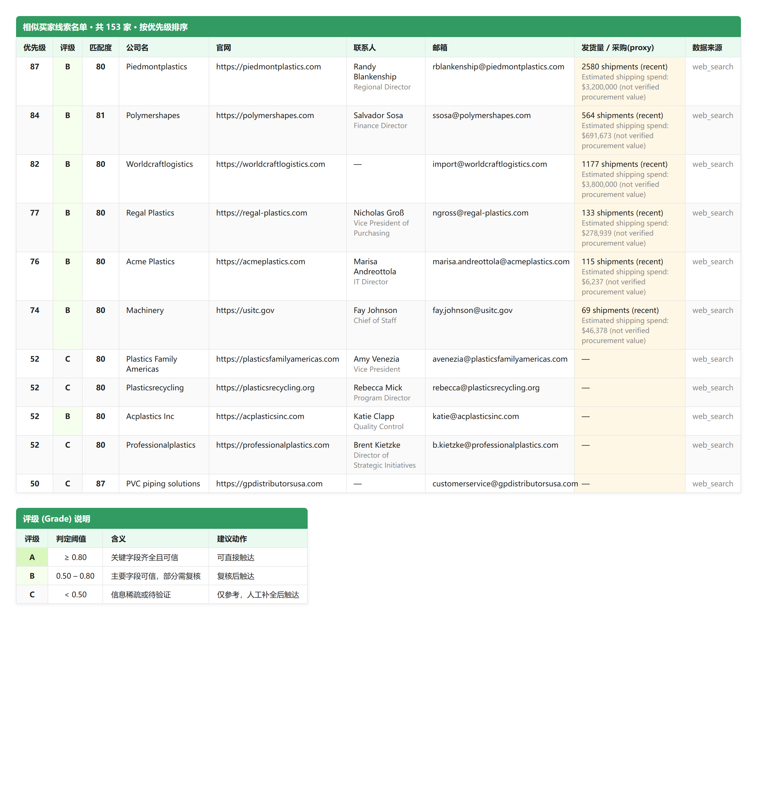

# Similar Value Customer Miner

> Hand it a list of customers you've already closed — it hands back a list of similar overseas (US) importers you haven't, with contact info, sources, and a confidence grade on every line.

[中文](README.md) · **English** — [Engineering ›](ENGINEERING.md)

Built for trade / BD teams: turn your "won customers" into a "similar prospects" list as a starting point for outreach. It does **research and organizing**, not judgment — many leads still deserve your review before you hit send.

> **About cost**: the skill **runs end-to-end at zero cost** (free web search + free email quota), but **best results depend on paid APIs** — precise HS-based customs discovery, shipment verification, and larger email quota all need paid data sources, from about $83/month. See the full cost tiers, per-service pricing, and money-saving tips in [数据成本与付费说明](docs/pricing.md) (Chinese).

---

## Dual-channel discovery: customs data + open web search

Start from your existing customers' industry / HS codes / main products. The miner searches two channels — customs import records (ImportYeti) plus open web search — for candidate US importers, then:

- **Excludes your own customers and industry leaders**, so every result is a *new* similar company
- **Merges and de-duplicates** across both channels, so you never see the same company twice
- Works even with no API keys, falling back to free web search

## Auto-fills website, contacts, emails, and socials

For each candidate company it tries to complete the official website, contact name and title, email, phone, and social links.

- **Coverage depends on public data** — not every company can be fully completed, and that's shown honestly rather than hidden
- Generic inboxes (like `info@`) are **labeled separately** from personal emails, so you know who you're actually writing to

## Shipment volume & freight estimates quantify buyer strength

For some companies you get shipment volume, import frequency, HS codes, and an **estimated shipping spend**.

- The estimate is a size reference only and is **clearly marked as an estimate**
- It is **not real customs purchase value** — that requires a commercial customs database, which this project hasn't wired in yet

## One Excel, three sheets: leads, details, grading legend



- Top: the **lead list**, sorted by priority; the orange "purchase (proxy)" column is a visual reminder that the number is an estimate
- Bottom: the **grading legend** — A / B / C tells you how trustworthy each row of data is

You get one structured Excel with three sheets: a clean lead list (sorted, ready to work from), full details (every field auditable), and a statistics & grading legend. Chinese headers, consistent fonts and colors.

## A/B/C trust grades + priority scores — know who to call first

| Grade | Meaning | Suggested action |
|-------|---------|------------------|
| **A** | Key fields complete and trustworthy | Reach out directly |
| **B** | Main fields trustworthy, some need review | Review, then reach out |
| **C** | Sparse or unverified info | Complete it manually first |

Two scores guide you, and they mean different things:

- `fit_score` — how similar the candidate is to your target profile
- `priority_score` — combines similarity, import strength, and contact completeness; **this is what the list is sorted by**

Every lead is also fact-checked by rules: purchase ≤ revenue × 70%, company existence, contact reachability, HS/region consistency — each row gets a `passed / pending / failed` status. An optional Google Fact Check step can attach **published external fact checks** as supporting references; it's corroboration, not proof of revenue or purchase volume.

> Heads-up: with free data tiers, a fair share of leads in a run often land at grade C (contacts not fully found). Take the top N by priority first, then complete those by hand.

## Every field carries source, confidence, and notes

Every field carries three things: **source, confidence (0–1), and notes**. Estimates, inferred values, and unverified items are explicitly labeled — nothing silently pretends to be a confirmed fact.

Data comes only from public sources:

- **Customs import records** (ImportYeti bills of lading): import categories, shipment volume
- **Open web search**: official sites and basic company info
- **Public email directory** (Hunter): contact emails, names, titles

No logged-in scraping, no personal privacy data.

## Get started in three minutes — a customer list is enough

1. A customer list (Excel / CSV) with at least a **target industry** or **HS code** (main products help)
2. Run it — no API key needed (free web search + free email quota); adding data-source keys makes results sharper
3. Open the Excel and work the list from the top

Cost: free to use. About **$83/month** (Apify + Hunter entry tiers) unlocks precise HS-based customs discovery, shipment verification, and more email quota. Full tiers and money-saving tips: [数据成本与付费说明](docs/pricing.md) (Chinese).

## Install into Codex / Claude Code / Kimi Code

This repo is a standard Agent Skill (with a `SKILL.md` at the root) and installs into all three mainstream AI coding assistants — just clone it into the assistant's skills directory:

```bash
# Kimi Code
git clone https://github.com/fyaic/similar-customer-miner-skill.git ~/.kimi-code/skills/similar-customer-miner

# Claude Code
git clone https://github.com/fyaic/similar-customer-miner-skill.git ~/.claude/skills/similar-customer-miner

# Codex
git clone https://github.com/fyaic/similar-customer-miner-skill.git ~/.agents/skills/similar-customer-miner
```

Once installed, tell your assistant "find similar customers for me" with your customer list, and it will invoke this skill automatically.

---

Architecture, data flow, configuration, APIs, and testing: **[Engineering ›](ENGINEERING.md)**

*License: MIT*
